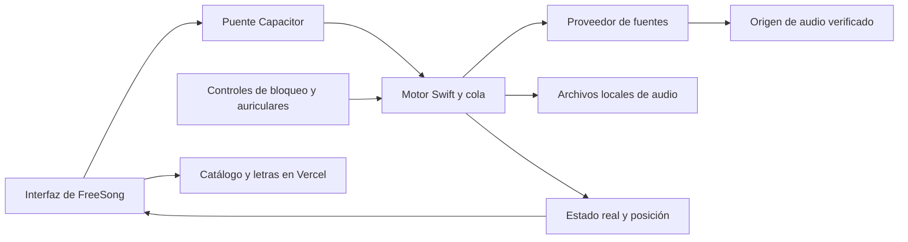

# Plan de recuperación y evolución de FreeSong

Plan histórico del motor nativo. La [guía de iPhone](../ios.md) describe
la instalación y el motor actuales.

Fecha: 15 de noviembre de 2026.
Estado: análisis y plan. No se publican cambios de reproducción en esta sesión.
Base revisada: commit `6910cf67fc89b5adeaffdff180ff051d95766b2d`, versión web/IPA 3.9.29.

## Objetivo y orden de trabajo

Recuperar primero la reproducción real del IPA, estabilizar audio y controles de
iPhone, implementar crossfade nativo y después ampliar las funciones de música.
La experiencia deseada toma Spotify como referencia funcional. No equivale a
obtener su catálogo, recomendaciones privadas, cuentas Premium o Spotify Connect
mediante la copia de otro proyecto.

No añadir otra capa de parches sin identificar el fallo. No sustituir evidencia
del IPA por pruebas de Chrome con identificación de iPhone. No borrar la app ni
su biblioteca como primer intento de reparación.

## Evidencia disponible

| Observación | Qué permite concluir |
| --- | --- |
| El usuario escuchó música y cambios de pista con el IPA 3.9.28 bloqueado. | Existió un recorrido funcional en su dispositivo. No es todavía una validación de todas las condiciones. |
| En esa sesión, el bloqueo mostraba play mientras seguía sonando. | Había un problema de sincronización visual. |
| Después de publicar 3.9.29, el usuario informa que ninguna canción suena en el IPA. | Hay una regresión o un fallo específico de ese entorno que debe tratarse como prioridad P0. La causa no está demostrada. |
| En esta revisión, 3.9.29 reprodujo Candy, pausó/reanudó y avanzó a otra pista en Chrome con identificación de iPhone. | El flujo web y esas fuentes respondieron en ese momento. No demuestra que el IPA funcione ni descarta problemas con otras canciones, IP, caché o red. |
| El IPA usa `server.url` de producción. | Un IPA anterior también carga la web publicada. Reinstalar el paquete viejo por sí solo no revierte el motor JavaScript. |
| AppDelegate configura AVAudioSession, pero la reproducción la realizan elementos HTML de audio. | El motor actual es híbrido; activar la categoría playback no lo convierte en AVPlayer. |
| El usuario informa que el crossfade no funciona en el IPA ni en la PWA de iPhone. | Coincide con una desactivación explícita en el código, no con una implementación nativa fallando. |

## Crossfade: causa confirmada

En `www/app.js`, el disparo automático y `shouldCrossfade` exigen `!isIOS` y
`!isBackground()`. Por ello, el ajuste de crossfade puede estar activado y aun
así nunca actuar en iPhone. Se introdujo esa restricción para reutilizar el
elemento de audio ya autorizado por iOS al avanzar bloqueado.

Problemas a resolver:

1. La interfaz ofrece una preferencia que no se ejecuta en ese dispositivo.
2. El IPA depende del mismo motor web y hereda la restricción.
3. Quitar únicamente `!isIOS` vuelve a exponer autoplay, volumen y suspensión
   de los dos elementos HTML; no constituye una solución validada.

En la PWA se mostrará disponibilidad real. Solo se ofrecerá crossfade donde se
haya verificado; el modo de primer plano y el de pantalla bloqueada deben
distinguirse. En el IPA se implementará una transición de audio nativa.

## Qué hace realmente SimpMusic

Se revisó el submódulo `core` fijado por SimpMusic a
`8413a257cbe45d102a9f101f2760e35b549e4d9e`.

- `StreamRepositoryImpl` pide una fuente al cliente YouTube, selecciona formato
  y conserva metadatos y caducidad; también puede invalidar un formato.
- `YouTube.player` combina una respuesta de player con extracción de URLs.
- `FaradayCipherEngine` implementa resolución de desafíos de firma/`n` y maneja
  datos del reproductor. No es un endpoint público de backend listo para Vercel.
- Existen carpetas `iosMain`, pero `ExpectMediaHandler.ios.kt` contiene una
  implementación pendiente y `Extractor.ios.kt` devuelve fuentes vacías.

La adaptación exige trabajo de plataforma. Su parte Android/JVM no puede
copiarse directamente a Swift ni resolver automáticamente las restricciones
de red de Vercel. La selección de fuentes debe realizarse en el contexto de red
donde se consumirán: una URL extraída desde un servidor puede no servir desde
el iPhone y viceversa. Esto se comprobará en la prueba de viabilidad, sin asumirlo.

Referencias verificadas:

- [Submódulo de SimpMusic](https://github.com/maxrave-dev/SimpMusic/blob/dev/.gitmodules).
- [Resolución y almacenamiento de formatos](https://github.com/maxrave-dev/core/blob/8413a257cbe45d102a9f101f2760e35b549e4d9e/data/src/commonMain/kotlin/com/maxrave/data/repository/StreamRepositoryImpl.kt).
- [Cliente YouTube](https://github.com/maxrave-dev/core/blob/8413a257cbe45d102a9f101f2760e35b549e4d9e/service/kotlinYtmusicScraper/src/commonMain/kotlin/com/maxrave/kotlinytmusicscraper/YouTube.kt).
- [Motor de firmas](https://github.com/maxrave-dev/core/blob/8413a257cbe45d102a9f101f2760e35b549e4d9e/service/kotlinYtmusicScraper/src/commonMain/kotlin/com/maxrave/kotlinytmusicscraper/cipher/FaradayCipherEngine.kt).
- [Reproductor iOS pendiente](https://github.com/maxrave-dev/core/blob/8413a257cbe45d102a9f101f2760e35b549e4d9e/data/src/iosMain/kotlin/com/maxrave/data/mediaservice/ExpectMediaHandler.ios.kt).
- [Extractor iOS vacío](https://github.com/maxrave-dev/core/blob/8413a257cbe45d102a9f101f2760e35b549e4d9e/service/kotlinYtmusicScraper/src/iosMain/kotlin/com/maxrave/kotlinytmusicscraper/extractor/Extractor.ios.kt).

Si se reutiliza código, revisar licencia y atribución de cada módulo. En esta
sesión no se ha incorporado código ajeno.

## Fase 0 — Recuperar el IPA y localizar la regresión (P0)

Entregable: una versión de recuperación que reproduzca de nuevo en el teléfono
y una explicación sustentada de la causa.

1. Conservar una muestra de canción fallida y los datos del entorno: versión
   del paquete, versión web cargada, iOS, red y diagnóstico local. Se recogerán
   al retomar; el usuario no tiene que repetir instalaciones ahora.
2. Añadir diagnóstico del entorno nativo y capturar el resultado real de
   `audio.play()` — error con nombre y mensaje —, errores de media, readyState,
   networkState, tiempo, fuente sin firmas, cambio de visibilidad y errores Swift.
   No registrar cookies, credenciales ni URLs completas firmadas.
3. Seguir una sola canción de extremo a extremo: toque → fuente seleccionada →
   respuesta/rango → bytes/formato → play aceptado → tiempo avanzando → audio
   audible. Una búsqueda que devuelve resultados no cuenta como prueba de audio.
4. Comparar en el mismo iPhone: Safari, PWA e IPA; red móvil y Wi-Fi cuando estén
   disponibles; audio local corto conocido y stream real. Una sola variable por
   comparación para distinguir motor, servicio, caché y red.
5. Probar aisladamente los cambios 3.9.29 de MediaSession/eventos frente al motor
   previo. Revisar especialmente escrituras repetidas de playbackState y la
   interacción del audio silencioso con AVAudioSession. Son hipótesis, no causa
   confirmada. No resolverlo aumentando reintentos ni forzando play infinitamente.
6. Preparar una reversión selectiva del cambio culpable si se confirma. Como el
   IPA carga producción, usar una compilación/ruta de diagnóstico fijada a una
   versión antes de publicar la recuperación. Un paquete viejo con la web nueva
   no es una comparación válida.

Criterio de salida: cinco canciones reales reproducibles en el IPA, pausa y
reanudación correctas, avance de cola y una descarga local reproducible. Guardar
resultados antes de ampliar funciones o reactivar crossfade.

## Fase 1 — Probar la obtención de audio al estilo SimpMusic (P1)

Entregable: un proveedor de fuentes independiente del reproductor, con prueba
real desde iPhone y contrato definido.

1. Definir `SourceProvider.resolve(trackId, quality)` con resultado: identidad
   de la pista, URL, MIME/codec, tamaño/duración cuando existan, caducidad, origen
   de resolución y cabeceras necesarias. No insertar URLs permanentes en favoritos.
2. Conservar lo que ya funciona para búsqueda, catálogo y letras en Vercel.
   Separar esas rutas de la resolución y transporte del audio.
3. Hacer una prueba pequeña de resolución en el dispositivo, con transporte
   nativo y formatos AAC/M4A o HLS que el iPhone pueda reproducir. Evaluar el
   mínimo adaptable de la arquitectura de SimpMusic y sus dependencias; su stub
   iOS impide tratar su biblioteca completa como producto terminado.
4. Comparar esa vía con un proveedor de resolución del lado servidor. Comprobar
   primer byte y rangos desde el consumidor, no solo que el resolvedor devuelva
   una URL. Elegir la vía demostrada; no montar un servidor de pago antes de
   comprobar que aporta una solución.
5. Respetar caducidad, invalidar un 403 y resolver de nuevo una vez; distinguir
   canción no disponible, login requerido, formato no compatible y fallo de red.
   No sustituir una canción por otra sin comprobar identidad y duración.
6. Precargar la siguiente fuente, conservar descargas y dejar el relay existente
   como respaldo durante la transición. La solución final no debe depender de
   una sola instancia pública sin comprobación de salud.

Criterio de salida: conjunto fijo de al menos veinte pistas variadas, prueba de
primer byte y seek, URLs caducadas y fallos explícitos; resultados reales tanto
en conexión móvil como Wi-Fi. Repetir otro día para detectar dependencias frágiles.

## Fase 2 — Motor nativo iOS y biblioteca offline (P1)

Entregable: audio controlado por Swift, conservando inicialmente la interfaz.

Arquitectura propuesta; no describe la implementación actual:

1. Implementar AVPlayer/AVQueuePlayer para reproducción básica; cola e intención
   del usuario con un único propietario nativo. Exponer cargar, reproducir,
   pausar, seek, siguiente/anterior y eventos al cliente.
2. Publicar Now Playing y comandos remotos desde ese mismo motor. Evitar que
   MediaSession web y el audio silencioso compitan con el reproductor nativo.
3. Resolver interrupciones, cambio de salida, auriculares, AirPlay/Bluetooth y
   recuperación de red. Guardar posición, cola y pista al salir.
4. Descargar con el sistema nativo a archivos persistentes y validar tamaño e
   integridad. Migrar o rehidratar las descargas existentes sin perder favoritos
   ni playlists: los `blob:` de WKWebView no son archivos que AVPlayer pueda abrir.
5. Empaquetar después la interfaz para abrir sin esperar la web de Vercel,
   adaptando las rutas API y las actualizaciones a ese modo. Registrar por
   separado versión del paquete, interfaz y motor. Evitar mezclas de caché.

Criterio de salida: reproducción continua durante treinta minutos bloqueado,
al menos diez cambios de pista, pausa/reanudación/seek/siguiente remotos y prueba
offline en modo avión, incluyendo relanzamiento. Todo en iPhone real.

## Fase 3 — Crossfade real en iPhone (P1)

Entregable: fundido audible y verificable en el IPA, sin sacrificar la continuidad.

1. Extender el motor con un coordinador de dos reproductores AVPlayer capaces
   de solaparse, o elegir AVAudioEngine si una prueba de viabilidad justifica su
   mayor complejidad. Un AVQueuePlayer único no aporta por sí solo un fundido
   cruzado entre dos pistas.
2. Precargar audio y preparar la entrada antes de la ventana de transición.
   Programar el inicio a partir del tiempo del reproductor nativo y realizar
   las curvas de ganancia en código nativo. No depender de setInterval de la web
   para avanzar cuando el teléfono está bloqueado.
3. Mantener una cola y una identidad de pista coherentes: definir cuándo pasan
   portada, letras y Now Playing a la entrante. Pausa, seek, siguiente, repetir
   una y temporizador de apagado deben cancelar o finalizar el fundido con una
   regla explícita, sin dos audios huérfanos ni doble salto.
4. Si la siguiente no está preparada, continuar con una transición normal;
   no cortar la pista actual ni fingir que se produjo un crossfade.
5. Corregir el ajuste en la PWA: disponibilidad y límites visibles. Comprobar
   por separado si existe un modo web viable en primer plano; no anunciar
   crossfade bloqueado en Safari sin haberlo demostrado.

Criterio de salida: duraciones mínima, intermedia y máxima del ajuste con audio
local y streaming; solapamiento audible medido, al menos cinco transiciones con
pantalla bloqueada y controles remotos durante el fundido, sin silencio inesperado,
picos de volumen ni cambios de pista duplicados.

## Fase 4 — Funciones tipo Spotify por grupos comprobables (P2)

| Grupo | Situación y trabajo previsto |
| --- | --- |
| Buscar, artistas, álbumes y playlists | Ya existen rutas y pantallas; completar paginación, errores y coherencia de metadatos. |
| Biblioteca, favoritos e historial | Existen localmente; reforzar copias, migraciones y recuperación sin pérdida. |
| Cola, aleatorio, repetir, radio y autoplay | Existen; compartir la lógica con el motor nativo y probar recomendaciones que llegan tarde. |
| Letras sincronizadas | Existen; validar desplazamiento, desfase y cambio de pista durante crossfade. |
| Descargas y modo offline | Existe Cache API en la web; completar gestor nativo, espacio disponible, reintentos y modo avión. |
| Inicio y recomendaciones | Evolucionar las reglas actuales con historial y preferencias; comprobar relevancia y carga rápida. |
| Audio | Crossfade nativo en fase 3; después normalización por pista, velocidad y ecualizador real si la arquitectura elegida lo permite. |
| Perfiles y sincronización entre dispositivos | No hay servicio de cuenta propio; diseñar persistencia y autenticación aparte si se requiere. |
| Conectividad | Primero rutas de audio de iOS. Un equivalente a control remoto entre dispositivos necesita protocolo y backend propios. |
| Podcasts, funciones sociales y listas colaborativas | Ampliaciones separadas, con proveedor de datos y criterios de aceptación propios. |

No llamar implementadas a funciones que solo tienen un botón o una preferencia.
Cerrar cada grupo con pruebas antes de empezar el siguiente.

## Fase 5 — Publicación y mantenimiento (P2)

1. Separar desarrollo, prueba y producción. Cada versión debe identificar qué
   se probó en Chrome, en simulador y en el iPhone físico.
2. Mantener regresiones automáticas y añadir pruebas del adaptador nativo. La
   compilación correcta de Xcode no demuestra reproducción audible.
3. Distribuir un IPA probado y una actualización web compatible, con migraciones
   reversibles de datos y mecanismo para volver a una versión estable.
4. Usar un informe de diagnóstico exportable por el usuario con versiones,
   errores y fuentes redactadas; no exigir reinstalar para investigar.
5. Documentar la renovación de AltStore por separado. Cambiar el backend o pasar
   a Swift no elimina el vencimiento de la firma gratuita.

## Primer trabajo al retomar

Empezar por la fase 0: capturar el fallo del IPA actual y comparar la
sincronización nueva con el motor anterior en el mismo teléfono. Después,
prueba de viabilidad del proveedor de fuentes. El crossfade nativo viene una
vez que reproducir, pausar y avanzar vuelvan a ser fiables.

Resultado de esta sesión: plan preparado, fuentes revisadas y crossfade
desactivado confirmado. La causa de que el IPA no emita audio sigue pendiente;
no se afirma que esté corregida ni se publica otra versión sin validarlo.

## Avance tras recibir el diagnóstico, 15 de noviembre de 2026

Las causas de fuentes rotas, duración incoherente y alternativa con el mismo ID
ya tienen correcciones y regresiones. Se implementaron el motor AVPlayer dual,
cola/precarga/crossfade nativos, Now Playing y el puente con migración de audio
local. La interfaz mantiene el origen de producción y aprovecha el worker en
WKWebView. La interfaz no se ha migrado a SwiftUI ni a un origen local nuevo.

La compilación inicial pasó; la revisión final y las pruebas de fuentes se validan
antes de publicar. Los criterios de salida en iPhone real siguen pendientes de
probar con el nuevo IPA. No se consideran completadas las funciones ampliadas de
Spotify, un extractor propio ni las descargas nativas en segundo plano.
